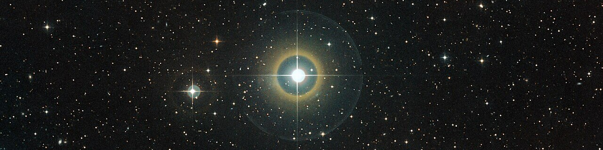
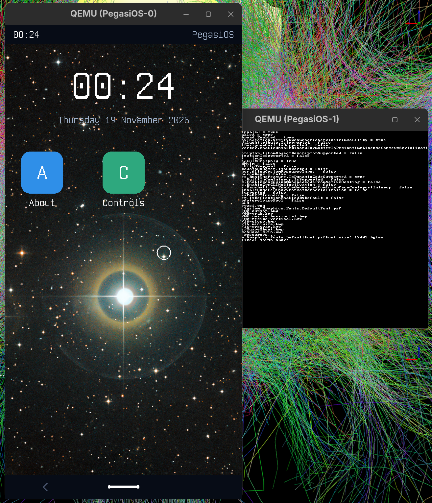

<br>
<sub>The sky around the star 51 Pegasi. Credit: [ESO/Digitized Sky Survey 2](https://www.eso.org/public/images/eso1517c/)</sub>

# PegasiOS

A phone operating system written in C# on [Cosmos](https://github.com/CosmosOS/Cosmos) gen3. The first target is the [PinePhone Beta Edition with Convergence Package](docs/pinephone.md).

PegasiOS is at its first steps: a kernel that boots in a virtual machine shaped like the phone and runs a small touch shell. It does not run on a real PinePhone yet.

<p align="center">
  <br>
  <sub>PegasiOS in the PinePhone virtual machine: the home screen on the phone's panel, and the boot log on the firmware's framebuffer.</sub>
</p>

## What works

- The kernel builds for ARM64 against Cosmos 3.0.97 from nuget.org.
- It boots in QEMU on a machine with the phone's CPU model, memory, panel size and storage size.
- It runs a shell on the 720x1440 panel: a status bar, a navigation bar with Back and Home, and three screens. Home has the clock and a tile per screen over a wallpaper, About lists the hardware the kernel found, Controls has a switch, a slider and a button that work.
- The shell's controls are built on Aura.UI, the UI kit of Aura Operating System: a library with a repository of its own, which other Cosmos kernels can reference too.
- The mouse stands in for the finger: the pointer is where the finger is, a click is a tap. Escape is Back.

[docs/pinephone.md](docs/pinephone.md) has the phone's specifications, what the virtual machine reproduces of them, and what the real device still needs.

## Requirements

- The [.NET 10 SDK](https://dotnet.microsoft.com/download).
- The Cosmos tools (clang, lld, xorriso, QEMU with the ARM64 firmware): `dotnet tool install -g Cosmos.Tools`, then `cosmos install`.
- The Aura.UI repository cloned next to this one, as `../Aura.UI`: the kernel builds the UI kit from that clone. A build without it stops with a message that says so.

## Build and run

```bash
make build    # output-arm64/PegasiOS.iso
make run      # build, then boot it in a QEMU window
make shot     # build, boot without a window, save the screen to out/home.png
```

The first build installs the Cosmos IL patcher of the pinned version under `.tools/`, so the global tools of the machine are not touched.

QEMU opens two windows: the tall one is the phone's panel, the other is the firmware's framebuffer, where the boot log is drawn. Click the panel to give it the mouse, and press Ctrl+Alt+G to take it back. The kernel log is on the terminal.

`scripts/vm-drive.py` boots the kernel without a window and plays steps on it (move the finger, tap, type a key, take a screenshot). It is how a change to the shell is checked. The finger starts at the center of the panel and `move` is relative, so this opens the Controls tile and saves what it shows:

```bash
python3 -I scripts/vm-drive.py --out out sleep=1 move=0,-272 sleep=0.4 tap sleep=0.8 shot=controls
```

The shell writes what it does on the serial line (`[PegasiOS] screen Controls`, `[PegasiOS] taps 2`), which lands in `out/uart.log`.

## Layout

| Path | What it holds |
|---|---|
| `src/PegasiOS/` | the kernel: `Kernel.cs`, the shell under `Shell/`, its touch controls under `Shell/Controls/`, the wallpaper under `Resources/` |
| `scripts/` | build, the PinePhone virtual machine, the screen driver |
| `docs/pinephone.md` | the device and its virtual machine |
| `global.json` | the Cosmos version everything builds against |

## License

BSD 3-Clause, see [LICENSE](LICENSE).

The banner and the home screen's wallpaper (`src/PegasiOS/Resources/51-pegasi.png`) are crops of an [ESO image](https://www.eso.org/public/images/eso1517c/), credit ESO/Digitized Sky Survey 2, under [CC BY 4.0](https://creativecommons.org/licenses/by/4.0/). The About screen shows the credit.
